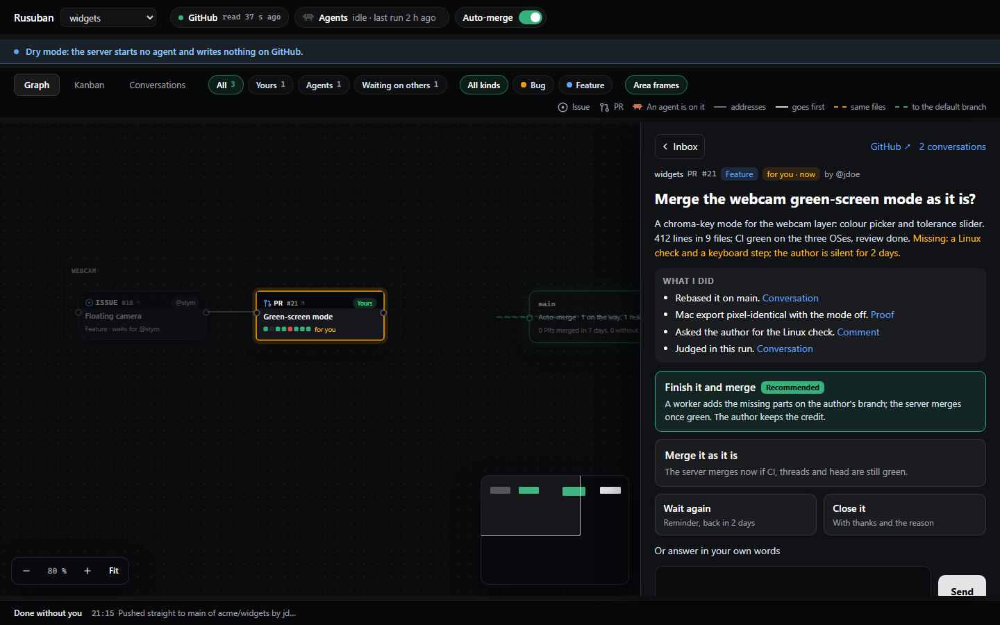

# Rusuban

Rusuban minds your project while you're away. It follows the rules you write in your repo, keeps the
Claude conversations about the project in one place, and calls you only when your rules say so.

Rusuban (留守番) is the Japanese word for whoever minds the house while you are out.



## What it does

- **Judges every issue and PR against your rules**, with Claude Code on the model you choose, and acts
  where they let it: it asks for a rebase, fixes a bug in its own worktree, and merges what your rules
  and its locks allow.
- **Brings you only the decisions your rules keep for you**, as cards with options and their effects,
  in one inbox for all your projects. You answer from the inbox or from the item's own card. It pings
  you on ntfy, Slack, Discord, Teams or e-mail.
- **Keeps your rules growing**: a question on how the agents work, a lock to lift or a setting to
  allow waits apart, under Rules & settings. When several cards ask the same, it proposes the rule
  that would answer them; a PR that changes your rules is yours to merge.
- **Keeps the Claude conversations about your issues and PRs**, held in your project's folders, each
  linked to the item it is about, with its own agents' runs. You read and answer them from the
  dashboard, on your desktop or your phone.
- **Runs recurring tasks** written as text, in a project of their own when they concern no repo.
- **Reserves your test machines** over SSH, one agent at a time. Your own desktop only after your yes.
- **Is set up from Claude**: its MCP server changes any setting, and whatever widens what agents may do
  waits for your yes in the dashboard.

## Getting started

You need Node 22 or later, and the GitHub CLI (`gh`) and Claude Code (`claude`) logged in.

```bash
npm install -g rusuban
rusuban init
```

`init` asks which Claude model the runs use, how agents may use this machine and whether to arm
automatic merges: there is no default for any of them. It adds your first repo, installs the service
that keeps Rusuban running, registers its MCP server for Claude Code, and opens the dashboard.

Then write your rules in your repo, under `.rusuban/rules/`: see [Writing rules](docs/writing-rules.md)
and the [examples](examples/rules/). Without rules, Rusuban only observes.

To reach the dashboard from your phone, `rusuban remote enable` serves it on your tailnet through
Tailscale.

Read the [security model](docs/security.md) before you let agents run any command on your machine.

## Docs

- [Writing rules](docs/writing-rules.md): where a project's rules live, what to write, how a change
  applies
- [Locks](docs/locks.md): what the server checks before it merges, and `locks.json`
- [Security model](docs/security.md): the deny rules, the host profiles, the dashboard's identity
  check, the residual risks
- [Setting Rusuban up from Claude](docs/claude.md): its MCP server, and what waits for your card
- [Test machines](docs/machines/README.md): what a machine needs, a setup script per system, your
  own desktop
- [FAQ](docs/faq.md)
- [Example rules](examples/rules/)
- [Changelog](CHANGELOG.md)

The design lives in [specs/001-autopilot](specs/001-autopilot/spec.md).

## License

[MIT](LICENSE)
