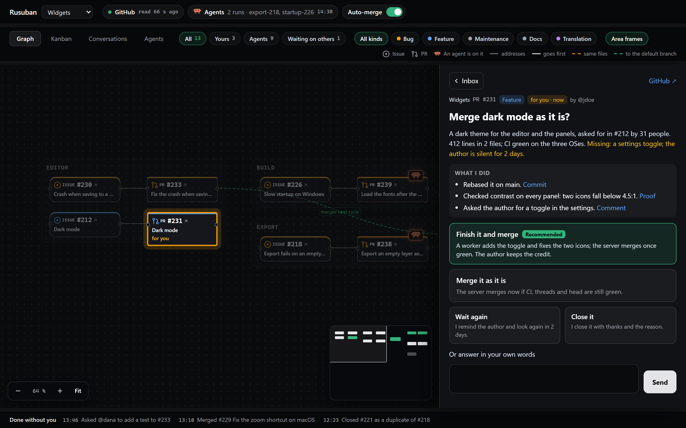
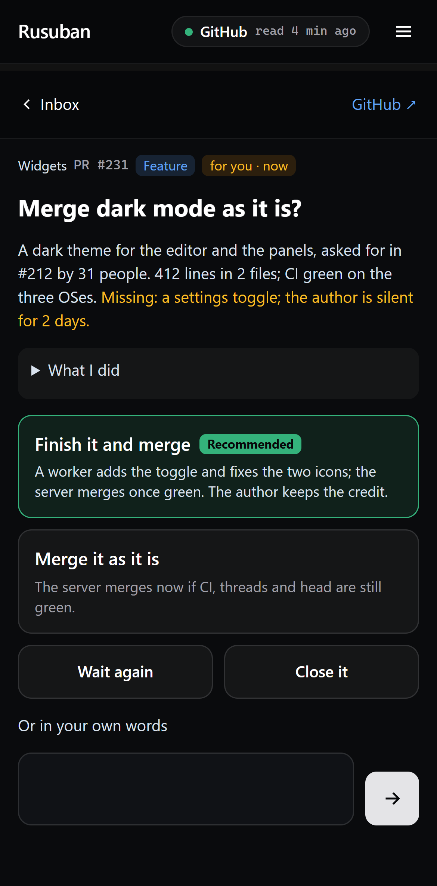

<h1 align="center">Rusuban</h1>

<p align="center">
  <b>Minds your GitHub projects while you're away.</b><br>
  Claude Code agents follow the rules you write, and call you only when those rules say so.<br>
  <a href="https://etiennelescot.github.io/rusuban/">etiennelescot.github.io/rusuban</a>
</p>

<p align="center">
  <a href="https://www.npmjs.com/package/rusuban"></a>
  <a href="https://github.com/EtienneLescot/rusuban/actions/workflows/ci.yml"></a>
  <a href="LICENSE"></a>
</p>



Rusuban is a local autopilot for maintainers of GitHub projects. It runs on your machine and reads
your repos' issues and PRs. Claude Code judges each one against the rules in your repo. What the
rules allow gets done. The rest comes to you as a card.

Rusuban (留守番) is the Japanese word for whoever minds the house while you are out.

## How it works


## What you get



- **One inbox for all your projects.** A card says what the agents did and asks one question. Each
  option says what happens next.
- **Your desktop or your phone.** Answer in the dashboard, or on your phone through your tailnet.
- **Pings when your rules say so**, on ntfy, Slack, Discord, Teams or e-mail.
- **Safe merges.** Agents never merge. The server does, behind locks: CI green on the exact head it
  checked, no open thread, no locked path.
- **Rules that grow.** When several cards ask the same thing, Rusuban proposes the rule that would
  answer them, as a PR you merge.
- **Every Claude conversation about an item**, linked to it, read and answered from the dashboard.
- **Recurring tasks** written as text, such as the release notes every evening.
- **Test machines** reserved over SSH, one agent at a time.
- **Set up from Claude.** Ask Claude Code to change a setting. What widens what agents may do waits
  for your yes.

<br clear="right">

## Get started

You need Node 22 or later, with `gh` and `claude` logged in. Rusuban runs on Windows, macOS and
Linux.

```bash
npm install -g rusuban
rusuban init
```

`init` asks which Claude model the runs use, what agents may run on this machine, and whether to arm
automatic merges. It adds your first repo, installs the service and opens the dashboard.

On Linux without a desktop session, run `loginctl enable-linger` once: otherwise systemd stops the
service when you log out.

Then write your rules in `.rusuban/rules/` in your repo, or start from an
[example](examples/rules/). Until then, Rusuban only watches.

To answer from your phone, `rusuban remote enable` serves the dashboard on your tailnet through
Tailscale.

## Docs

- [Writing rules](docs/writing-rules.md): where rules live and what to write
- [Locks](docs/locks.md): what the server checks before it merges
- [Security model](docs/security.md): read it before agents run commands on your machine
- [Setting Rusuban up from Claude](docs/claude.md): its MCP server
- [Test machines](docs/machines/README.md): what a machine needs, a setup script per system
- [FAQ](docs/faq.md) and [changelog](CHANGELOG.md)

The design lives in [specs/001-autopilot](specs/001-autopilot/spec.md).

## License

[MIT](LICENSE)
