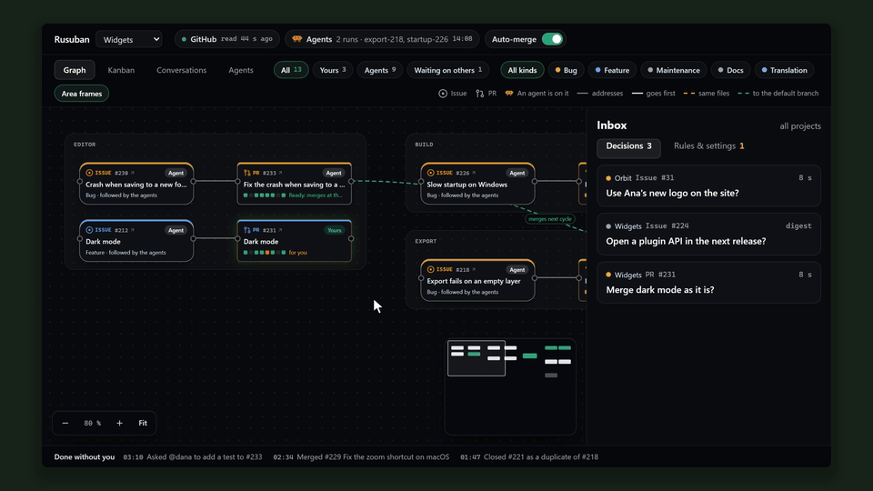

<p align="center">
  
</p>

<h1 align="center">Rusuban</h1>

<p align="center">
  Claude Code agents mind your GitHub projects by the rules you write, and call you only when those rules say so.
</p>

<p align="center">
  <a href="https://www.npmjs.com/package/rusuban"></a>
  <a href="https://github.com/EtienneLescot/rusuban/actions/workflows/ci.yml"></a>
  <a href="LICENSE"></a>
</p>

<p align="center">
  
</p>

## What you get


- **Only your decisions reach you.** Agents judge every issue and PR against the rules in your
  repo. What the rules allow gets done. The rest comes to you as one card, with a recommended
  answer.
- **One click to answer.** Each option says what happens next. Answer in the dashboard, or on
  your phone through your tailnet. Pings come on ntfy, Slack, Discord, Teams or e-mail when your
  rules say so.
- **Merges you can trust.** Agents never merge. The server does, behind locks: CI green on the
  exact head it checked, no open thread, no locked path.
- **Rules that grow.** When several cards ask the same thing, Rusuban proposes the rule that
  would answer them, as a PR you merge.

<br clear="right">

## Get started

You need Node 22 or later, with `gh` and `claude` logged in. Rusuban runs on Windows, macOS and
Linux.

```bash
npm install -g rusuban
rusuban init
```

`init` asks which Claude model the runs use, what agents may run on this machine, and whether to
arm automatic merges. It adds your first repo, installs the service and opens the dashboard.

Then write your rules in `.rusuban/rules/` in your repo, or start from an
[example](examples/rules/). Until then, Rusuban only watches. The
[install guide](https://rusuban.dev/docs/install/) covers Linux servers and answering from your
phone.

## Learn more

The site is **[rusuban.dev](https://rusuban.dev/)**: how it works, the features, and how Rusuban
compares with other tools.

- [Writing rules](docs/writing-rules.md): where rules live and what to write
- [Locks](docs/locks.md): what the server checks before it merges
- [Security model](docs/security.md): read it before agents run commands on your machine
- [Setting Rusuban up from Claude](docs/claude.md): its MCP server
- [Test machines](docs/machines/README.md): what a machine needs, a setup script per system
- [FAQ](docs/faq.md), [changelog](CHANGELOG.md) and the
  [design](specs/001-autopilot/spec.md)

## License

[MIT](LICENSE). Rusuban (留守番) is the Japanese word for whoever minds the house while you are
out.
